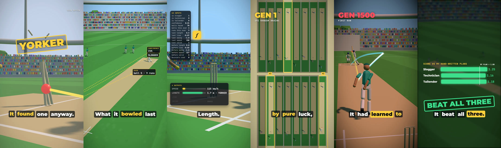
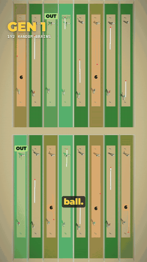
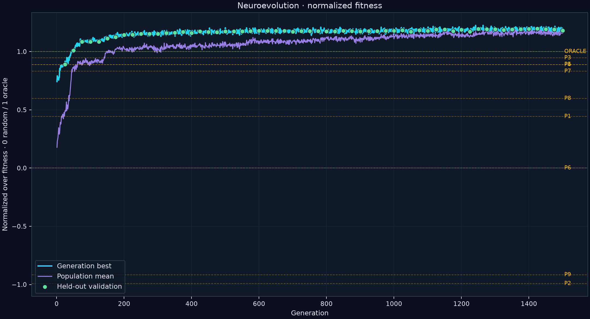
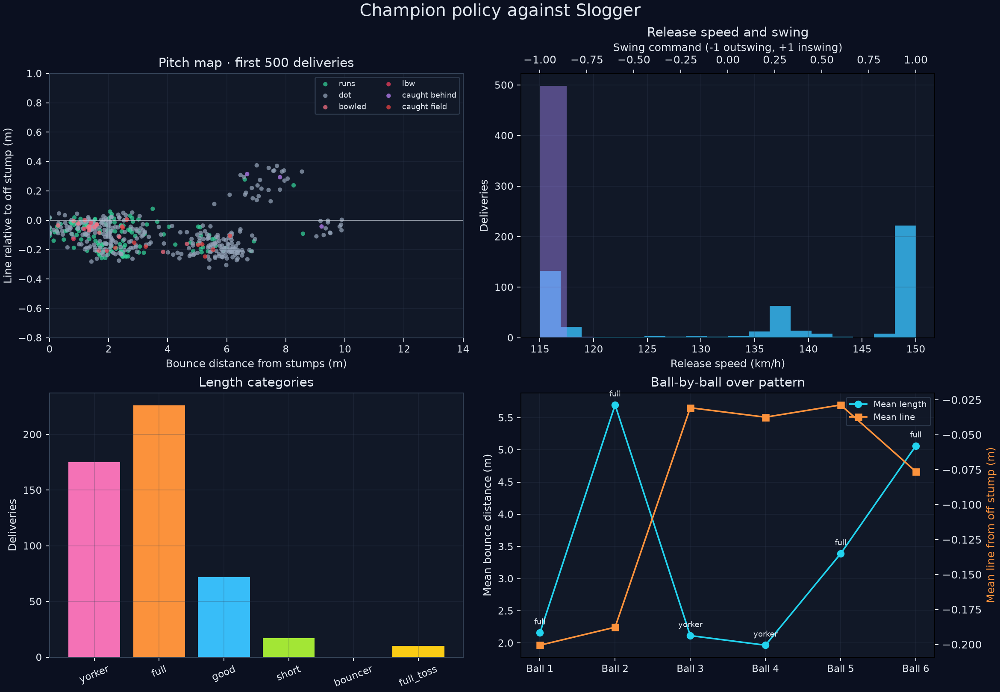
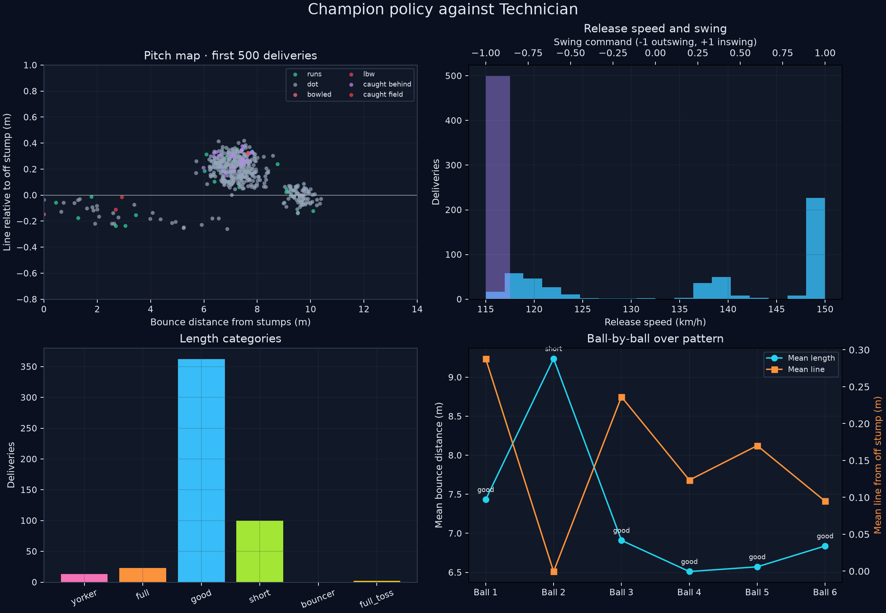
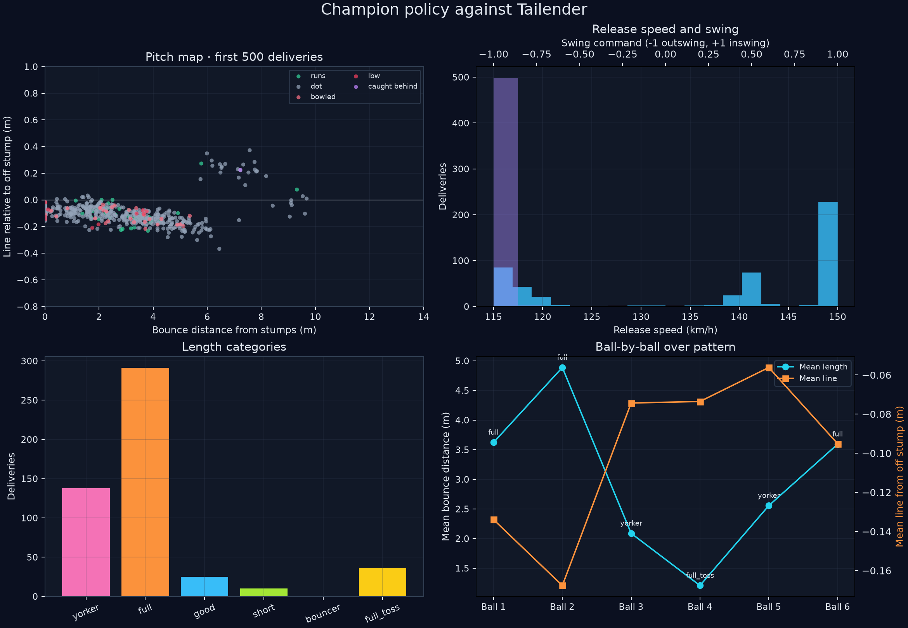

# The Machine That Learned to Bowl

**A fast bowler that taught itself to bowl by neuroevolution: 192 neural-network brains, 1,500 generations, about 83 million simulated deliveries, against three adaptive batters. Along the way it learned to cheat, and had to be beaten fairly.**

> 🎬 **Watch the film (2:46):** [download from the v1.0 release](https://github.com/MuhamadYousuf/the-machine-that-learned-to-bowl/releases/tag/v1.0) · 9:16 and 4:5



<p align="center"></p>

<p align="center"><i>Generation 1: sixteen random brains in the nets at once. Green = wicket, orange = hit for four or six.</i></p>

---

## What this is

A cricket bowling simulation built from scratch in Python:

- **Physics:** a ball-flight model in SI units with gravity, quadratic air drag, seam swing, bounce and seam deviation, stepped every 2 ms. Every release gets a random execution wobble, so plans have to be robust.
- **Batters that think:** three archetypes, each with hidden weakness zones and scoring zones:
  - **the Slogger:** aggression 0.94; punishes full and short balls; weak to yorkers and slower balls
  - **the Technician:** skill 0.91; leaves wide balls, blocks straight ones; weak to good length moving away late
  - **the Tailender:** skill 0.30; weak to full and straight balls and the short ball at the body

  Batters track what you've been bowling (length, line, movement, pace). Repetition builds their **confidence**, surprise beats them, and they read alternating patterns from the last two balls. Every batter is varied by up to 15% each over.
- **The bowler's brain:** a 18 → 24 → 24 → 4 tanh MLP (1,156 weights). Inputs: batter type, confidence, the state of the over, the last two deliveries. Outputs: speed, elevation (length), azimuth (line) and swing.
- **Evolution, not gradients:** 192 genomes per generation, each bowling 48 overs. Elitism (top 8), tournament selection, uniform crossover, and cosine-annealed Gaussian mutation. Training is crash-safe and resumable, with lineage logged for a family tree.

## The story in numbers

| | v1 (the cheat) | v2 (the real bowler) |
|---|---|---|
| What it learned | Bouncer, yorker, bouncer, yorker at 115 or 150 km/h, with 3 (illegal) bouncers an over | A plan per batter |
| Why | Batters judged surprise only by distance from expectation, so extremes were always "surprising" | Batters now read lag-2 patterns; max 2 bouncers an over |
| Score vs hand-written expert plans* | 0.62 / 0.65 / 0.66 | **1.25 / 1.16 / 1.18** |

\*Normalised so random bowling = 0 and a hand-written expert plan for each batter = 1 (Slogger / Technician / Tailender), re-tested under the fair v2 rules.

The v2 champion (generation 1425):

| vs | Wickets / over | Runs / over | Its plan |
|---|---|---|---|
| Slogger | 0.44 | 5.7 | 34% yorkers, 51% full: straight at the stumps |
| Technician | 0.21 | 1.2 | 73% good length on fourth stump |
| Tailender | 0.34 | 1.5 | 60% full, 28% yorkers, **zero bouncers** (the expert plan used two) |



| Slogger | Technician | Tailender |
|---|---|---|
|  |  |  |

**Known limitation:** the champion's swing output is pinned to full outswing on every ball. Outswing is the classic fast bowler's weapon, but it's a habit, not a choice.

## Quick start

```bash
py -3.14 -m venv .venv
.venv\Scripts\python.exe -m pip install -r requirements.txt
.venv\Scripts\python.exe -m pytest                     # 65 tests
```

Replay the trained champion (`models/ga2_champion.npz`) or train your own:

```bash
.venv\Scripts\python.exe scripts\train.py --name ga2 --gens 1500 --pop 192 --workers 8 --noise 0.05 --eval-overs 16
.venv\Scripts\python.exe scripts\evaluate.py --name ga2 --checkpoint champion.npz --overs 100
.venv\Scripts\python.exe scripts\analyze_run.py --name ga2
.venv\Scripts\python.exe scripts\dashboard.py --run ga2      # http://localhost:8050 · live training + Brain Explorer
```

On an 8-core CPU a 1,500-generation run takes about 6.4 hours, and you can stop and `--resume` it at any time.

## The film

The film is rendered from the simulation's own data, so every ball and statistic on screen is real.
Its story follows the project:
1. The hook: a yorker that nobody taught it.
2. What the bowler "sees": 18 inputs in, 4 outputs out.
3. The 1,156-weight brain.
4. Generation 1: carnage in the nets.
5. Selection and mutation.
6. The generation-1500 cheat.
7. The rule change.
8. Starting again: the rise from 12.1 to 0.4 runs an over.
9. The three plans that beat my hand-written ones.

| Layer | Tool | What |
|---|---|---|
| Simulation world | Remotion + three.js | A low-poly daylight stadium and practice nets; mannequin bowler (run-up, bound, windmill arm released at the sim's release point) and batter (two-bone arm IK, shot-specific bat keyframes timed to the ball's arrival) |
| Ball flights | simulator replays | Every trajectory interpolated from 4 ms samples (<1 mm error); the nets show 16 real genomes from each generation at once |
| HUD and story graphics | Remotion | Sensor rays, input panel, output meters, the network built from the champion's real weights, generation badges, stamps, the score vs expert plans |
| Narration | Chatterbox TTS + Whisper | Each line voiced with its own emotion and pacing; three takes per line, auto-checked by Whisper, best take kept; captions use the script's words with Whisper's timings |
| Music and sound | NumPy/SciPy | An original synthesised score that follows each act, ball and HUD sound effects, voice ducking, -14 LUFS master |

How to rebuild it is in [video/README.md](video/README.md).

## Repository layout

| Path | What |
|---|---|
| `src/aibowler/` | physics, batters, outcome model, environment, policy, evolution, replays, dashboard data |
| `scripts/` | training, evaluation, analysis, dashboard, video data exporters |
| `tests/` | 65 tests: physics calibration, batter behaviour, training determinism and resume, video data |
| `models/` | the v2 champion, the v1 "cheater" champion, the v2 training log and config |
| `docs/` | [SPEC.md](docs/SPEC.md) (full design), [PROGRESS.md](docs/PROGRESS.md), figures |
| `video/` | Remotion project (`src/reel/` is the film), narration and audio scripts, Blender scenes and edit planners for the earlier documentary cuts |
| `src/aibowler/lab/` | *Experimental:* a tactics lab for real players (Cricsheet calibration, scouting reports). See [docs/LAB.md](docs/LAB.md) and [docs/VISION.md](docs/VISION.md) |

## Credits

- Narration: [Chatterbox TTS](https://github.com/resemble-ai/chatterbox) (MIT), voice prompt made with [Kokoro-82M](https://huggingface.co/hexgrad/Kokoro-82M) (Apache-2.0); transcripts by [faster-whisper](https://github.com/SYSTRAN/faster-whisper) (MIT)
- Night sky HDRI (earlier documentary cuts): [Poly Haven](https://polyhaven.com) (CC0)
- Earlier documentary cuts only: bowler character and motion capture from *Cricket Bowling Animations Pack* by HK (Hamza Khan), Unity Asset Store. **Not included in this repository** (licensed for use, not redistribution).
- Ball-by-ball data for the experimental lab: [Cricsheet](https://cricsheet.org) (ODC-BY)

## License

Code and data: [MIT](LICENSE). Third-party assets keep their own licences (see Credits); the Unity Asset Store pack is not part of this repository.
